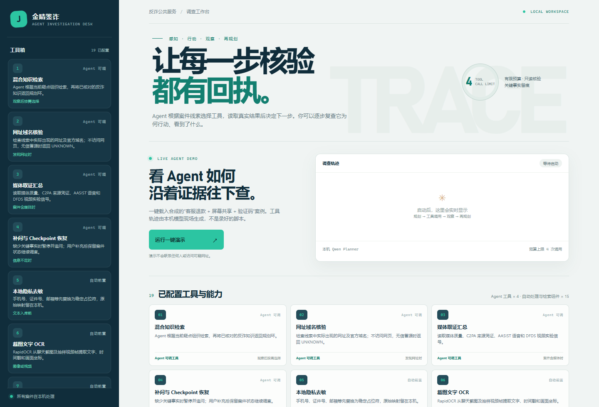

# 金睛鉴诈：多模态反诈调查原型

聊天截图、来电录音、短视频和用户描述经常一起出现。这个项目想解决一个实际问题：收到一条线索后，系统能不能把不同来源的信息放在一起核对，遇到证据不足时继续调查或向用户追问，并留下能复查的过程？

仓库基于已有竞赛项目源码做了本地化改造。原项目的 Flutter、React、Spring Boot 等模块仍在仓库中；新增的 Agent 工作台是一个独立的本地入口，目前没有接回原客户端和 Spring 链路。

## 先跑起来

工作台使用本地 Qwen 模型。权重没有放进 Git，首次运行前按[模型资产说明](docs/model_assets.md)准备模型。Windows PowerShell 下：

```powershell
cd "模型后端\模型后端\模型后端"
python -m venv .venv
.\.venv\Scripts\Activate.ps1
pip install -r requirements-local.txt
python local_web.py
```

打开 `http://127.0.0.1:5050`，点击“一键体验 Agent”。演示会创建一个合成案件，不需要填写真实个人信息。没有 BGE 或 Whisper 权重时，向量召回或音视频转写会按实现降级。模型下载位置和来源记录见[模型资产说明](docs/model_assets.md)。

## 演示里发生什么

样例案件包含“退款客服”“屏幕共享”“短信验证码”和一个示例网址。程序先做媒体线索提取、隐私替换和确定性规则检查；知识检索和 URL 核验不会在案件录入时自动跑，而是交给 Agent 按当前观察决定是否调用。Agent 根据工具回执继续核验、改问或结束；例如网址工具返回 `UNKNOWN` 时，它不会把未知当成安全。



这是 W6 前的首页截图，当时目录展示 19 项能力；当前目录已扩到 28 项。调查轨迹会在启动演示后生成。一次浏览器流程的记录见[W5 集成评估](reports/W5-integration-evaluation.md)。

## 为什么这里用了 Agent

媒体解码、脱敏、规则匹配和检索都由普通代码完成；这些步骤输入明确，不需要让模型自由决定。Agent 用在后续调查路径取决于新发现的地方：它读取案件状态，选择允许的工具，观察工具返回，再决定继续、换工具、追问还是结束。

LangGraph 图只负责通用的 `plan → execute → plan → report` 循环；可调工具通过注册表声明描述、适用条件、副作用和执行函数。扩展工具时不需要在 LangGraph 里加一条专用工作流分支。Planner 从当前状态可用的工具里选择动作，每轮最多 8 次，并由案件级 SQLite Checkpoint 保存调查记忆。工具回执进入下一轮观察；Agent 可调用检索、网址核验、媒体复核、止损建议、材料清单、本机视频检索和复核工单。它不会替用户冻结账户或提交报案。工具失败会写入轨迹，同参重复调用会被拦截。工具说明及调用边界见[架构与运行路径](docs/architecture.md)。

URL 默认只做本地静态预检，不访问目标网站。用户在案件页明确确认后，才可将已观察 URL 提交到 urlscan.io，并请求 private 可见性；这仍属于向第三方外送。运行守护进程也必须显式指定单一本地目录：

```powershell
cd "模型后端\模型后端\模型后端"
python -m jinjing.guardian --watch-dir "D:\anti-fraud-inbox"
```

将文件放入该目录后，守护进程等待文件稳定，完成案件提取与 Agent 调查，再将文件移至 `_jinjing_processed`；失败文件移至 `_jinjing_failed`。它不会常驻扫描其它目录。

如需使用 URL 私有扫描，可在当前 PowerShell 会话临时配置密钥 `$env:URLSCAN_API_KEY = "你的 API key"`。不要把密钥写进仓库；案件页会在每次提交前单独要求确认外送。

这不是多 Agent 系统。这里的 Agent 是一个受限调查循环，工具结果也不是司法结论。

## 代码和项目记录

| 想看的部分 | 位置 |
|---|---|
| 本地工作台入口 | `模型后端/模型后端/模型后端/local_web.py` |
| Agent 与案件状态 | `模型后端/模型后端/模型后端/jinjing/agent.py` |
| RAG、规则与知识来源 | `模型后端/模型后端/模型后端/jinjing/retrieval.py`、`knowledge/` |
| 设计与运行路径 | [架构说明](docs/architecture.md) |
| 分阶段实现记录 | [W0–W9 报告](reports/) · [W8 业务工具说明](reports/W8-response-tools.md) · [W9 处置工具扩展](reports/W9-operations-tools.md) |
| Agent 岗位能力映射 | [Agent JD 能力映射](docs/agent-jd-playbook.md) |
| 演示讲解和证据索引 | [作品集讲解材料](docs/portfolio-evidence.md) |

## 目前做到哪里

已有实现包括本地媒体线索处理、PII 替换、风险规则、按需 BM25/BGE 检索、可扩展工具注册表、补问与恢复、证据时间线与引用检查、复核工单、历史相关视频检索和 opt-in 守护进程。运行工程测试：

```powershell
cd "模型后端\模型后端\模型后端"
python -m unittest discover -s tests
```

当前套件 24 项通过。工程测试通过也不代表模型识诈准确率。

当前知识库规模较小，缺少足量盲测数据和 Agent 与固定工作流的对照评估。AASIST/DFDS 相关输出仍是未校准的实验信号；陌生网址可能只能标记为未知。本机视频检索仅按哈希及抽取文本找候选。隐私替换也可能漏掉 OCR 错字、面部或声纹等信息。工作台只适合本机演示，任务状态保存在进程内存中，服务重启后可能丢失；没有多用户权限或生产级工单治理。

原始项目的分工和奖项证明不在仓库里。阅读代码时可以把 `APP/`、`前端/`、`Spring后端/` 视为原项目模块，把本地 Agent 工作台及 W0–W9 改造记录作为本仓库的后续工作线索；具体个人职责应以实际完成内容和可提供的证明为准。
