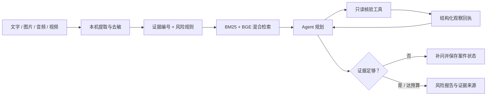
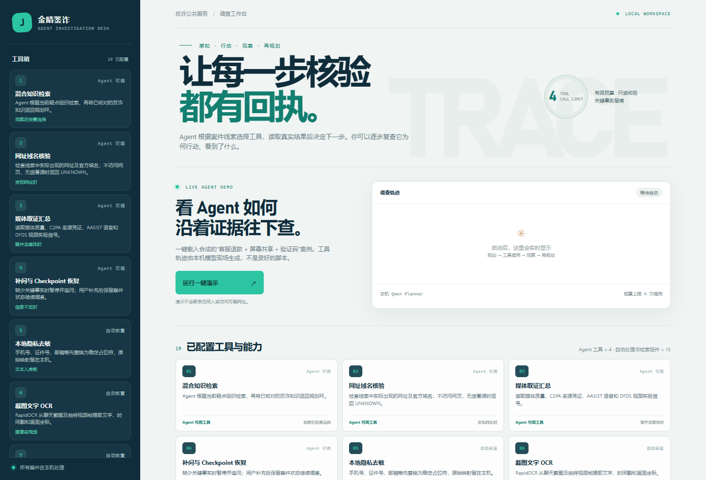
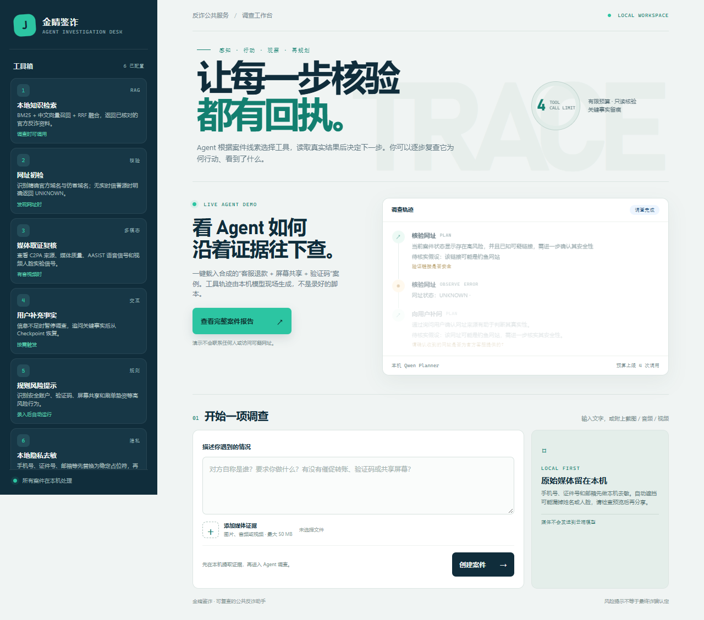

# 金睛鉴诈｜证据驱动的多模态反诈调查 Agent

> 面向视频、语音、截图和文字线索的本地调查工作台。先把线索整理成可追溯证据，再由受限 Agent 选择核验工具；每次行动都有观察回执，证据不足时补问或停止。

**项目形态：** 本地可运行的工程原型　|　**重点：** 多模态取证、隐私边界、RAG、Agent 工具循环　|　**不宣称：** 公网生产服务、已验证的深伪识别准确率或 Agent 准确率提升

## 先看它解决什么问题

反诈线索往往分散在聊天截图、来电录音、短视频和用户描述中。单次 LLM 调用容易漏掉跨模态线索、无法核验来源，也难以解释结论来自哪里。金睛鉴诈把任务拆成两段：确定性代码负责媒体处理、隐私替换和高危规则；Agent 只在证据不完整、后续核验取决于新观察时，按预算调用只读工具并重新规划。



## 现场演示

仓库包含本机 Web 工作台：工具目录展示 19 项能力；“一键体验 Agent”会创建**合成案例**，实际运行本地 Agent，并呈现规划、工具调用、观察结果和报告。演示样例中的 `.example` 网址不会被联网访问。



*首页截图。轨迹由点击演示后运行时生成；截图中的空轨迹区域是尚未启动演示时的状态。*



*W5 浏览器烟测截图：合成文本案例经过异步提交并显示调查结果。演示证据不是性能基准或识别效果评测。*

```powershell
cd "模型后端\模型后端\模型后端"
python -m venv .venv
.\.venv\Scripts\Activate.ps1
pip install -r requirements-local.txt
```

首次运行前，按[模型资产记录](docs/model_assets.md)准备本地权重。至少需要将 Qwen2.5-Instruct 放到 `models/qwen2.5-0.5b-instruct/`（或准备 1.5B 目录）；模型权重不随 Git 提交。随后启动：

```powershell
python local_web.py
```

浏览器访问 `http://127.0.0.1:5050`，点击首页的“一键体验 Agent”。RAG 向量召回和本地音视频转写分别需要 BGE、Whisper 权重；缺失时按实现降级或标为不可用。首次安装的 PyTorch、媒体库与模型权重较大，完整演示不适合在线沙箱直接启动。

如果从模型后端目录下载轻量 Planner，可运行：

```powershell
python -m pip install huggingface_hub
hf download Qwen/Qwen2.5-0.5B-Instruct --local-dir ..\..\..\models\qwen2.5-0.5b-instruct
```

1.5B Planner 可替代 0.5B，但需要更多内存和推理时间；型号、来源及校验记录见[模型资产记录](docs/model_assets.md)。

## Agent 在运行时做什么

```text
感知案件与现有观察 → 选择下一项核验 → 执行只读工具
          ↑                              ↓
     更新调查计划 ← 记录来源、证据 ID、状态、耗时与限制
```

- **能根据新观察改变下一步：** LangGraph `plan → execute → plan`，Planner 只从当前案件允许的动作中选择；同参重复调用会阻断。
- **会在证据不足时暂停：** `ASK_USER` 通过案件级 SQLite Checkpoint 保留调查状态，收到补充事实后继续。
- **失败有回执：** 工具错误进入观察和轨迹，Agent 可在剩余预算中改选工具或结束；当前自动重试为 0。
- **有可复查的证据链：** 工具观察记录状态、来源、证据编号和限制，报告保留阶段调用与耗时信息。
- **动作有边界：** 只读工具、调用预算、URL 来源校验、PII 门禁和媒体弃权共同限制 Agent；调查结果不是司法结论。

## 项目与个人贡献如何阅读

本仓库是在既有项目源码基础上的**本地化改造工作区**，不是原项目从零开发记录。原始项目的成员分工、个人职责和奖项证明没有随本仓库提供，因此本 README 不据此认定个人贡献或奖项。

| 代码范围 | 在仓库里的位置 | 阅读时的归属边界 |
|---|---|---|
| 既有系统：Flutter、React、Spring Boot 与模型 API | `APP/`、`前端/`、`Spring后端/`、`模型后端/` 下旧版 `app.py` / `services/` | 来自原始压缩包中的既有项目源码；不能因为它们出现在本仓库，就表述为本轮从零实现。客户端 → Spring → 旧模型 API 是原有集成路径。 |
| 本地 Agent 调查工作台 | `模型后端/模型后端/模型后端/local_web.py`、`jinjing/`、`templates/`、`static/` | 本地化改造路径：浏览器直接访问 5050 工作台；工作台调用案件处理、RAG 与 LangGraph Agent，不经过 Spring。 |
| 本仓库后续阶段改造 | `reports/W0–W6`、`docs/agent-jd-playbook.md`、`模型后端/模型后端/模型后端/tests/` | 报告记录了阶段实现和验证；准备简历时仅将本人实际完成、能指向代码并能讲解的部分写为个人职责。Git 提交作者信息只说明提交记录，不能单独证明原始工程由个人独立实现。 |

两个运行路径目前并列存在，不能说成 Agent 已接入 Flutter / React / Spring 全链路。

本仓库阶段记录按改造顺序公开问题、实现、验证与失败边界：

| 阶段 | 主要交付 | 可复查材料 |
|---|---|---|
| W0–W1 | 清理旧入口风险；新增本机媒体工作台、证据编号和隐私预处理 | [W0](reports/W0-baseline.md) · [W1](reports/W1-local-media-privacy.md) |
| W2 | 高危规则、来源可追溯的 BM25/BGE 混合检索与降级 | [W2](reports/W2-rules-rag.md) |
| W3–W4 | 受限 Agent 回路、Checkpoint、媒体取证信号和弃权 | [W3](reports/W3-agent.md) · [W4](reports/W4-media-forensics.md) |
| W5–W6 | 异步工作台、浏览器流程、工具契约、失败重规划与阶段观测 | [W5](reports/W5-integration-evaluation.md) · [W6](reports/W6-agent-engineering.md) |

岗位映射和面试口径见[Agent JD 能力映射](docs/agent-jd-playbook.md)；按“工程问题—设计选择—测试证据—限制”组织的讲解提纲见[作品集讲解与证据索引](docs/portfolio-evidence.md)。面试时应能现场讲清楚一次工具失败后的观察如何进入下一轮、为什么补问、预算耗尽如何收敛，以及哪些原始项目模块属于团队协作。

## 技术栈与代码入口

| 层次 | 主要技术 | 入口 |
|---|---|---|
| 本地调查 Web | Flask、Jinja、原生 JavaScript | `模型后端/模型后端/模型后端/local_web.py` · `templates/` · `static/` |
| Agent 运行时 | LangGraph、Pydantic、SQLite Checkpoint、本地 Qwen | `模型后端/模型后端/模型后端/jinjing/agent.py` |
| 媒体与隐私 | OpenCV、RapidOCR、faster-whisper、规则脱敏 | `模型后端/模型后端/模型后端/jinjing/` |
| RAG 与风险规则 | BM25、可选 BGE 向量召回、RRF、来源元数据 | `模型后端/模型后端/模型后端/jinjing/retrieval.py` · `knowledge/` |
| 原始客户端与业务端 | Flutter、React、Spring Boot | `APP/` · `前端/` · `Spring后端/` |

## 验证结果与诚实边界

- 当前工作区复核：完整运行 21 项自动化测试，全部通过；覆盖去敏、规则证据、检索来源、Agent 重规划、Checkpoint 补问、工具错误和 Web 流程。阶段记录中的 19 项是 W5 当时结果。测试通过说明工程行为符合用例，不等于诈骗识别准确率。
- 当前权威知识库只有少量人工核对资料；尚缺足量盲测集，以及同模型、同工具、同预算下 Agent 与固定流程的任务级对照。
- AASIST / DFDS 输出是未校准的实验信号，不构成“深伪识别准确”或真伪判断；模型缺失时必须标不可用。陌生网址风险也可能是 `UNKNOWN`，不能据此认定安全。
- 去敏可能遗漏姓名、地址、侧脸、OCR 错字或声纹；隐私优先不代表隐私保证。Web 工作台只监听本机回环地址，不能部署为公共服务。
- Web Job 生命周期目前在进程内存中，服务重启可能丢失任务状态；没有多用户隔离、持久任务队列或生产可观测平台。

## 本地 API 与旧版服务

新增本机工作台接口和异步任务说明见[本机 API v1](docs/local_api_v1.md)。旧模型 API 从同一目录执行 `python app.py`，默认监听 `127.0.0.1:5000`，健康检查为 `/health`。旧版云端能力按需从启动它的 PowerShell 会话读取 `QWEN_API_KEY`、`XFYUN_APP_ID` 和 `XFYUN_API_KEY`；本地 Agent 合成文本演示不需要这些云端密钥。旧版远程媒体 URL 端点默认拒绝所有主机。不要将 `.env` 或模型权重提交到仓库；原始压缩包曾包含的第三方凭据应在服务商处轮换，并在公开前检查整个 Git 历史，而不只检查当前工作区。

回归命令：

```powershell
python -m unittest discover -s tests -v
```

系统模块关系、两个 Web/API 运行路径和数据边界见[架构与运行路径](docs/architecture.md)；模型来源、路径和校验值见[模型资产记录](docs/model_assets.md)。原始项目材料不在本仓库，评审个人职责或奖项时应以可提供的原始证明为准。
