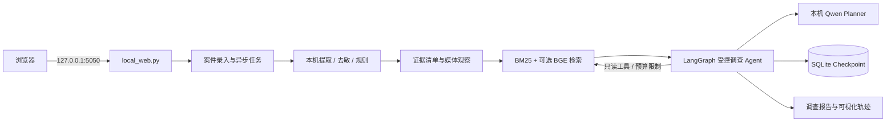
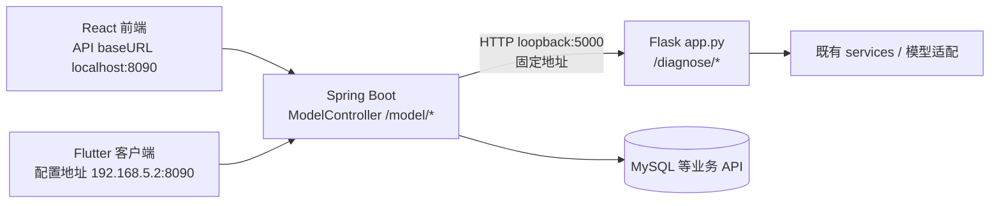

# 架构与运行路径

本文区分仓库中既有的客户端/业务 API 与后续新增的本机 Agent 工作台。两条演示路径目前并行，不能描述为 Agent 已经接入 Flutter、React 和 Spring 的完整客户端链路。

## 本地 Agent 工作台（作品集主演示）

- 入口：`模型后端/模型后端/模型后端/local_web.py`，只绑定 `127.0.0.1:5050`。
- 路径：提交文字或媒体 → 建立案件和证据 ID → 本机去敏/媒体处理/规则 → Agent 按可用工具和剩余预算核验 → 生成带观察回执的报告；证据不足可停下来补问。
- 模型：本机 Qwen 权重不在 Git 仓库中。Agent 工作台运行需要在仓库根目录 `models/qwen2.5-0.5b-instruct/` 准备模型，或准备符合代码检测条件的 1.5B 模型。ASR、BGE 与实验媒体模型分别依赖各自本机权重；模型缺失会降级或标记不可用。
- 状态边界：SQLite 保存案件级 Agent Checkpoint；Web Job 的 `QUEUED/RUNNING/...` 状态仍在单进程内存，服务重启可能丢失。工作台没有多用户隔离和公网部署设计。

## 既有客户端和兼容模型 API

- Spring 的 `ModelController` 固定请求 `http://127.0.0.1:5000`；Flask 旧入口 `app.py` 也绑定回环地址。两者必须在同一台开发机或同一网络命名空间中运行，否则 Spring 无法访问 Flask。
- React 前端 API 配置在 `前端/前端/src/utils/Api.ts`，默认指向 `http://localhost:8090`。Flutter API 配置在 `APP/APP/lib/services/api_service.dart`，默认指向 `http://192.168.5.2:8090`，这是开发环境地址，换设备/网络前需修改。
- Spring → Flask 是既有 `/model/*` 兼容调用路径。它与新增 Agent 工作台不是同一个入口；`local_web.py` 自己处理案件状态、证据和 Agent 调查，不经 Spring `ModelController`。
- 旧 Flask 端点可能依赖云端凭据或白名单主机配置；新工作台的合成文本 Agent 演示使用本地 Qwen。不要将前者的环境变量配置当作 Agent 工作台的必需条件，也不要把两个路径都概括为“完全离线”而不说明范围。

## 目录与资产归属

| 路径 | 用途 | 说明 |
|---|---|---|
| `模型后端/模型后端/模型后端/` | Python Flask API 与新增 Agent 工作台 | 当前主作品集演示代码；历史命名重复，后续可在确认脚本依赖后重命名 |
| `Spring后端/Spring后端/` | Java Spring Boot 业务 API 与旧模型 API 适配 | 原有工程代码为主，Spring 的 `/model/*` 转发至 Flask 5000 |
| `前端/前端/` | React/Vite 客户端 | 默认调用 Spring 8090 |
| `APP/APP/` | Flutter 客户端 | 当前配置地址 `192.168.5.2:8090` |
| `third_party/aasist/` | 第三方音频模型代码 | 保留其上游来源和许可证说明 |
| `reports/`、`docs/` | 阶段记录、运行契约、来源和评测边界 | 浏览器截图用于展示界面流程，不是准确率或产品效果证明 |
| 根目录 `models/` | Qwen、ASR、BGE 与实验媒体模型权重 | 被 Git 忽略；按 `model_assets.md` 中的来源和校验信息单独准备 |

## 从哪条路径开始

只想现场展示本轮 Agent 改造时，按根目录 README 启动 **5050 本地工作台**即可。除非面试需要解释原有 Flutter/React 到 Spring 再到旧 Flask 模型 API 的集成，不必为了演示 Agent 同时启动全部旧系统。

完整集成体验还需要按各端的数据库、Redis、上传目录、模型服务和开发机地址配置启动 Spring、Flask 与客户端。当前 README 尚未提供一条覆盖所有这些依赖的一键启动脚本，因此不要把仓库描述成克隆后即可一键启动全栈系统。
